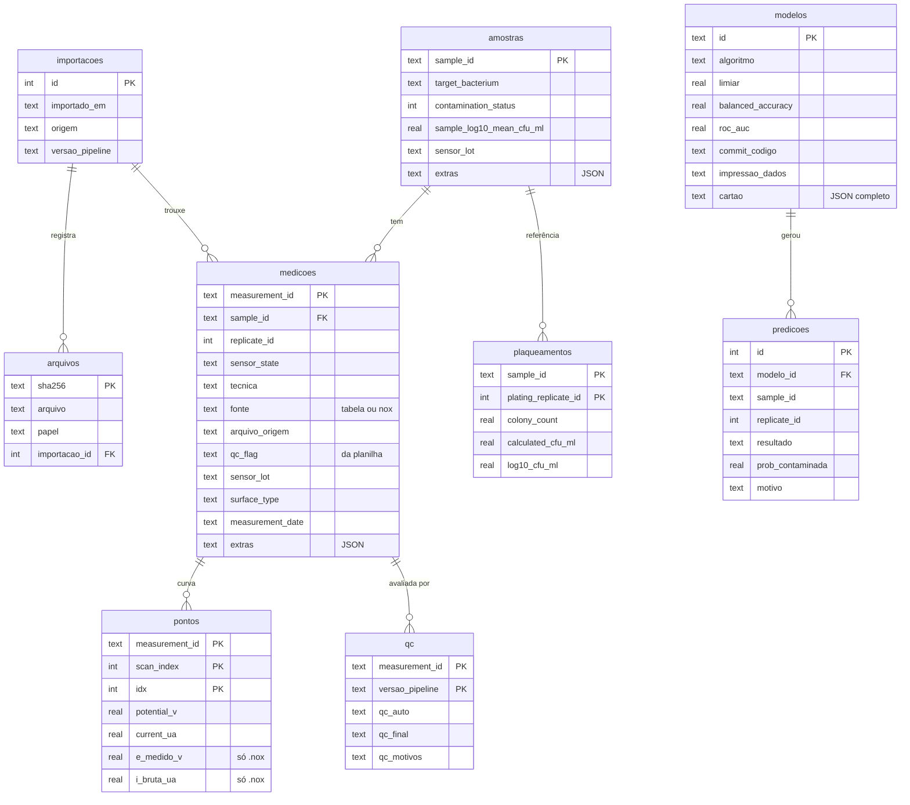

# Banco de dados (SQLite)

Arquivo único, padrão `dados/fiep.db` (fora do Git). Abre no
[DB Browser for SQLite](https://sqlitebrowser.org/) ou no [DBeaver](https://dbeaver.io/), em Python
(`sqlite3`, `pandas.read_sql`) e exporta para Excel ou CSV. O esquema usa SQL padrão, para facilitar
a migração para Postgres quando houver coleta contínua nas empresas.

## Comandos

```bash
fiep db importar --entrada Dados                 # lê .nox/tabelas, grava e roda o QC
fiep db importar --entrada coleta_empresa1/      # novos lotes: soma ao que já existe
fiep db resumo
fiep db sql "SELECT * FROM v_replicatas WHERE n_aprovadas < 3"
fiep db exportar --saida dados/fiep_banco.xlsx   # uma aba por tabela
fiep db exportar --formato csv --saida dados/exportacao/

fiep treinar --db dados/fiep.db                  # treina com o banco e registra o modelo
fiep treinar --db dados/fiep.db --filtro "tecnica = 'DPV' AND sensor_lot <> 'L03'"
fiep prever --entrada nova_coleta/ --db dados/fiep.db   # grava as previsões
```

Use `--db outro_caminho.db` para trabalhar com outro arquivo.

**Reimportar não duplica**: medições são atualizadas pelo `measurement_id`, os pontos daquela medição
são substituídos e cada arquivo é identificado pelo SHA-256 do conteúdo (`arquivos`). Cada execução
fica registrada em `importacoes`.

## Esquema



Colunas de metadados que não têm campo próprio (ex.: `incubation_time_h`, `species_code`) são
guardadas em `extras` (JSON) e voltam como colunas normais em `db.carregar()`.

### Views

| View | Para que serve |
|---|---|
| `v_medicoes` | medição + amostra + QC atual + nº de pontos (a tabela mais útil para olhar os dados) |
| `v_replicatas` | 1 linha por amostra+réplica: quais estágios existem e quantos passaram no QC |
| `v_qc_atual` | resultado mais recente do QC de cada medição |
| `v_predicoes` | previsões com o algoritmo e a acurácia do modelo que as gerou |

## Consultas úteis

```sql
-- Réplicas que não podem ser usadas no modelo (faltam estágios ou foram reprovadas)
SELECT * FROM v_replicatas WHERE n_aprovadas < 3;

-- Medições reprovadas no QC, com o motivo
SELECT measurement_id, arquivo_origem, qc_final, qc_motivos FROM v_medicoes WHERE qc_final <> 'PASS';

-- Balanceamento das classes por bactéria
SELECT target_bacterium, contamination_status, COUNT(*) FROM amostras GROUP BY 1, 2;

-- Amostras com medição mas sem plaqueamento de referência
SELECT a.sample_id FROM amostras a LEFT JOIN plaqueamentos p USING (sample_id) WHERE p.sample_id IS NULL;

-- De onde veio cada medição
SELECT m.measurement_id, ar.arquivo, i.importado_em, i.origem
FROM medicoes m JOIN importacoes i ON i.id = m.importacao_id
JOIN arquivos ar ON ar.importacao_id = i.id AND ar.arquivo = m.arquivo_origem;

-- Histórico de modelos
SELECT id, algoritmo, balanced_accuracy, roc_auc, n_amostras, commit_codigo FROM modelos ORDER BY criado_em;

-- Acerto das previsões em amostras que já tinham rótulo
SELECT modelo_id, AVG((resultado = 'CONTAMINADA') = rotulo_informado) AS acerto, COUNT(*) AS n
FROM predicoes WHERE status = 'avaliada' AND rotulo_informado IS NOT NULL GROUP BY modelo_id;
```

## Em Python

```python
from fiep import db
con = db.conectar("dados/fiep.db")
ds = db.carregar(con, "tecnica = ?", ("DPV",))        # Dataset pronto para treinar/prever
import pandas as pd
pd.read_sql("SELECT * FROM v_replicatas", con)
```

## Cuidados

- O arquivo `.db` fica **fora do Git** (`dados/` e `*.db` estão no `.gitignore`). Guarde cópias no
  drive do projeto; o SQLite não tem backup automático.
- Para copiar o banco com segurança, feche os programas que estiverem com ele aberto (ou use
  `fiep db exportar`).
- `VERSAO_ESQUEMA` em `fiep/db.py` controla mudanças futuras no esquema.
